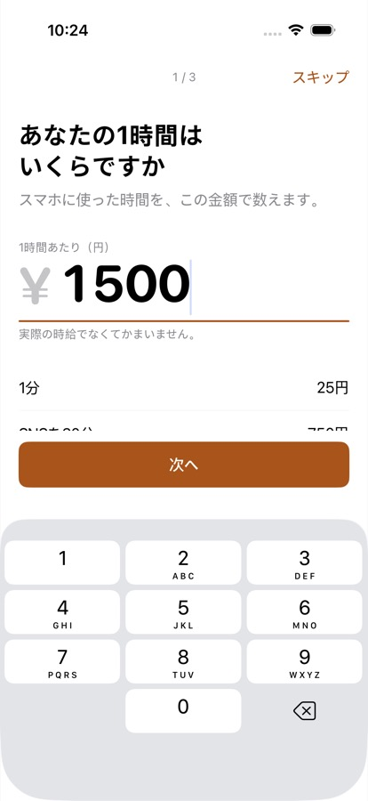
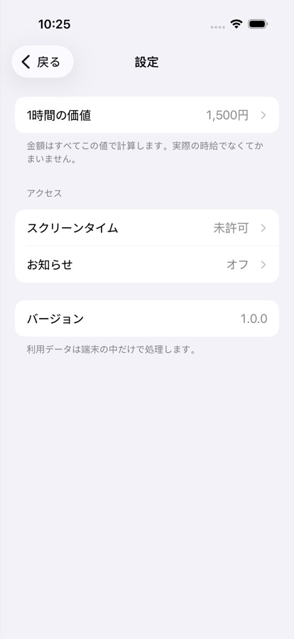
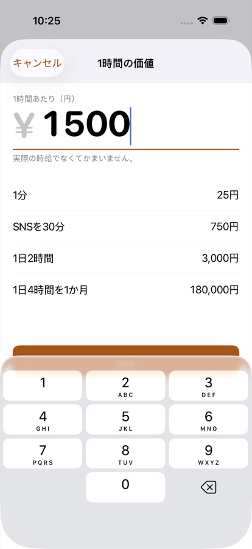
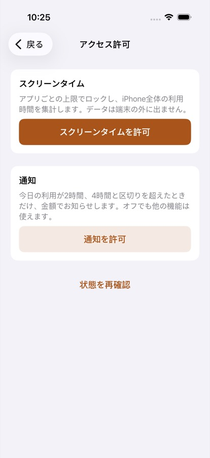
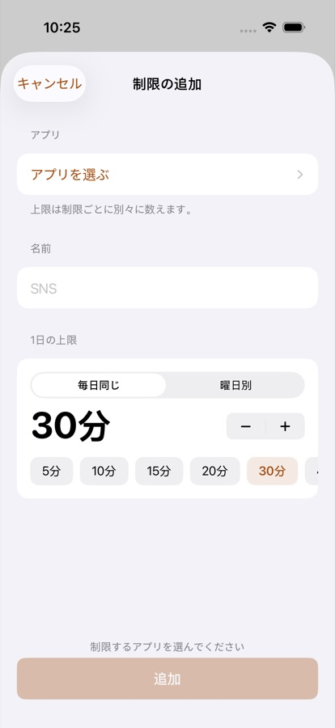
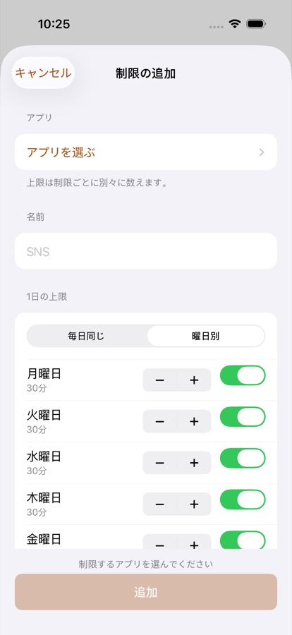
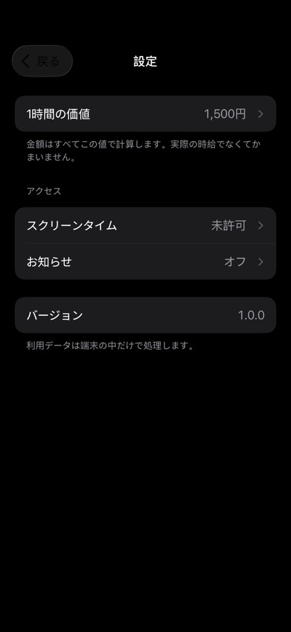
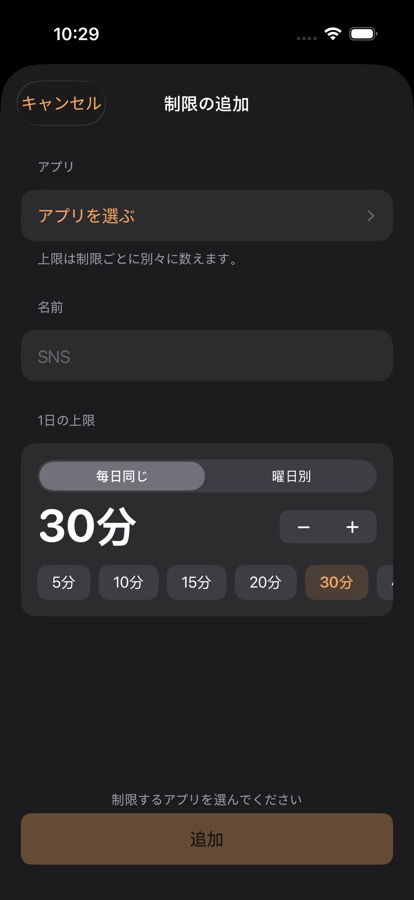
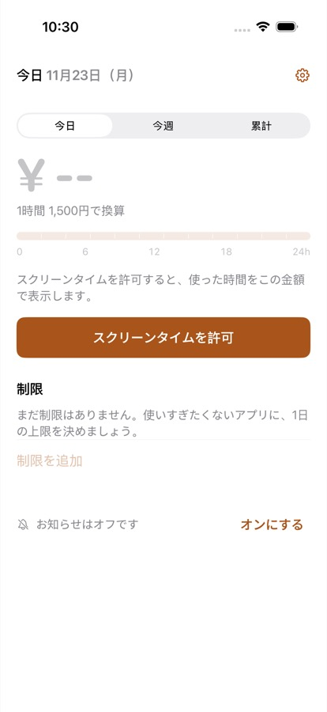

# iOS CI run 14

- Run: https://github.com/MoooonCrypto/time-is-money/actions/runs/45151556794
- Commit: 1eaba667fb8ce9810ccf18fbce38b8c56961d1f4
- Video: artifact `ios-ci-14` (ui-flow.mp4)

